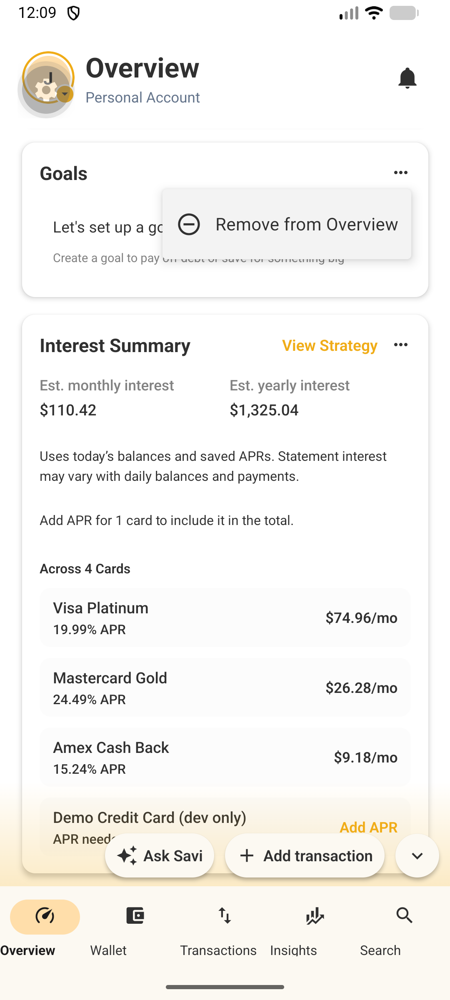
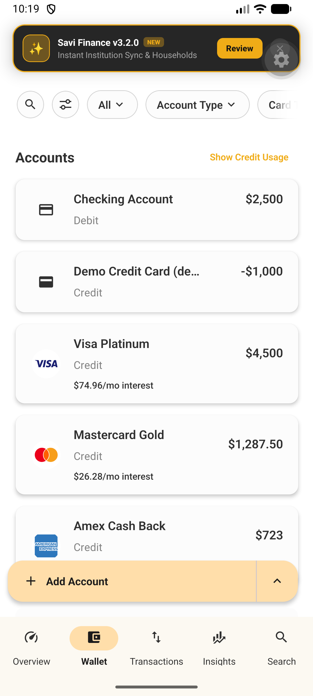
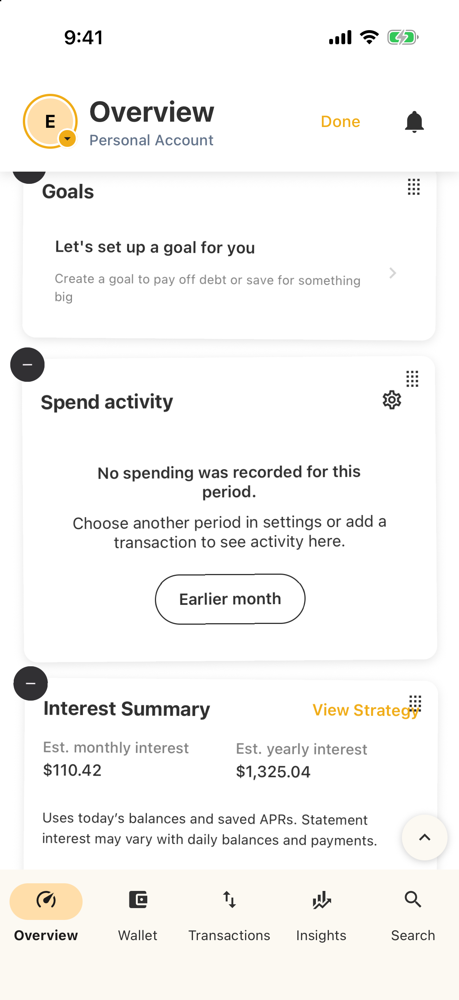
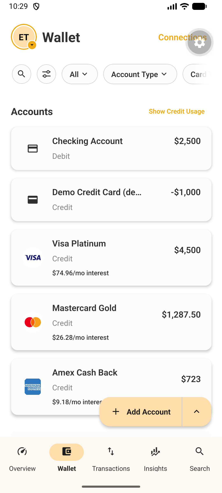

# D3 Product Evolution Report

## Project: Savi Finance – AI Interfaces and Custom Financial Widgets

## Team: 404 Team Name Not Found

---

Phase 1 of our plan, AI-generated widgets on the Overview screen, is what we demoed in D2. D3 has two parts. First, we improved and refined Phase 1 based on feedback after the D2 demo. Second, we prepared Phase 2, which extends customization beyond the Overview, by building prototypes: whole-app themes generated by Ask Savi, custom views for the Transactions and Wallet lists, and a custom financial calculation prototype.

## 1. What Needed to Improve

After D2, our team identified several limitations in the existing widget experience and AI-generated financial workflow.

The first issue was the Overview editing experience. In D2, a widget could only be removed from its own card menu, one card at a time, and reordering was a separate drag, even though Overview is meant to be quick to tailor. We also found a layout bug in the shared Add button on the Transactions and Wallet screens: on Android, it kept widening until it covered the bottom of the screen. Both issues came from partner feedback after D2 and our testing while preparing the next phase.

The second issue was **widget management and completion of the widget creation workflow**. Users needed better ways to find saved widgets, manage their visibility, compare generated designs, save a selected widget safely, and place it on the dashboard. Retry, cancellation, and partial-failure behaviour also needed to be more reliable.

We identified these gaps through partner feedback, testing, integration work, and team reflection on the D2 implementation.

Our goal for D3 was therefore not simply to add more individual features. We wanted to make the existing widget experience more direct and reliable while also creating a more reusable foundation for future financial interactions.

**Phase 2.** After D2, AI customisation stopped at the edge of an Overview widget: every other screen kept one fixed look, and the only appearance choice was Light, Dark or Follow System ([PR #6284](https://github.com/cheapreats/ce/pull/6284)). Asking Ask Savi to "make the app feel calmer" produced text and nothing to apply. At the D2 partner review, Ralph asked for a better UI experience, and in next-phase planning with him we chose to extend AI customisation beyond widgets, with whole-app themes as the first prototype.

Custom views address the lists themselves. On the Android emulator, transactions could only be grouped by date, and sorting by amount broke those date groups apart. The Wallet account list had no sorting at all, and its Account Type filter offered only 4 of the 6 types the list shows.

The custom financial calculation prototype addresses the **scalability of AI-generated financial views**. D2 demonstrated that users could request predefined financial views such as spending by category, expense totals, trends, comparisons, and transaction lists. However, a more customized financial question could still require another hard-coded implementation.

For example:

> “How much of my income did I save this month?”

does not directly correspond to one of the original fixed views. If every new type of financial question required another dedicated flow, the system would become increasingly difficult to extend and maintain.

---

## 2. What We Did

### 2.1 Direct Overview Editing

We replaces the per-card menu with an edit mode modelled on the iOS home screen. A long press on any widget starts edit mode: widgets jiggle, and each one that can be hidden shows a `−` badge. Tapping the badge removes the widget in place, and the existing Undo toast still puts it back in the same position for four seconds. Done, the Android back button or leaving Overview ends edit mode, and taps on widgets are ignored while editing, so a jiggling card never opens by accident. The same long press also lifts the widget for drag-and-drop, so removing and reordering start from one gesture. Hidden widgets can still be restored from Customize widgets.

The same PR fixes the Add button shared by Add transaction (Transactions) and Add Account (Wallet). It measured its own container, so its width grew on every layout pass; it now measures the label with a hidden, absolutely positioned copy.

#### Design Decision

Removal reuses the existing `isVisible: false` flag (`uiStateManager.setWidgetVisibility`), which is already stored per user on the device, instead of adding a separate deleted-widget state. Customize widgets, Undo and edit mode therefore share one piece of state, with no backend change or data migration. Edit mode lives in its own hook, `useWidgetEditMode`, which owns entering and leaving edit mode and the Android back button, so `HomeScreen` and `WidgetRenderer` only read `isEditing`.

### 2.2 Widget Management and Discovery

We also improved the broader widget-management experience.

The work in [PR #6586](https://github.com/cheapreats/ce/pull/6586) adds show/hide controls and creator badges, making widget state and origin clearer to the user.

Reset behaviour was also improved. Resetting built-in widgets preserves custom widgets and their pinned state instead of resetting the user's entire configuration.

To improve discovery, we added **Created** and **Last Updated** filters that can be combined with existing search and widget-type filters.

The date picker supports:

- seven-day presets;
- thirty-day presets;
- custom date selection;
- Apply behaviour;
- Cancel behaviour;
- validation of invalid date ranges.

These changes make the widget library easier to navigate as users accumulate more saved widgets.

---

### 2.3 Widget Design Selection and Saving

Another D3 improvement continued the widget-generation workflow after the initial request had been confirmed.

US-02 connects a confirmed widget request to chart selection, private saving, and initial dashboard placement.

Users can compare:

- **Bar**
- **Donut**
- **Line**

previews inside the authenticated Ask Savi workflow.

Bar and Donut views display category spending, while Line displays daily spending for the same account and month.

Validation checks that the financial totals represented across the views remain consistent before allowing the user to compare them.

We implemented the:

```text id="y5b75h"
previewMonthlyExpenseWidget
saveWidgetDesign
```

endpoints and connected the selection interface to the existing widget renderer.

The backend verifies account permissions before saving and stores only the selected widget definition in MongoDB.

Dashboard placement remains profile-specific and is stored separately on the device.

We also added stronger behaviour around cancellation and retries:

- cancelling before saving creates no widget;
- stable request identifiers prevent duplicate widgets;
- repeated saves are handled safely;
- if cloud saving succeeds but dashboard placement fails, placement can be retried without saving the widget again.

This was important because backend persistence and dashboard placement are separate operations and can fail independently.

---

### 2.4 Phase 2 prototype: whole-app themes with Ask Savi ([PR #7727](https://github.com/cheapreats/ce/pull/7727))

Ask Savi can now design a theme for the whole app from a description such as "a calm deep ocean at night". It answers with a card showing swatches and a sample. **Try it** restyles the entire app without saving; **Keep** saves the theme to the user's account, so it follows them to every device, and **Revert** discards it. After Keep, a toast offers **Undo** for 8 seconds. Account → Theme lists the custom theme beside Light, Dark and Follow System.

**Design decisions.**

- **Bounded format.** A theme is versioned JSON that changes only background, surface, text and outline colours plus roundness and text-size presets; the gold accent, status colours, fonts and spacing never change. As with D2 widgets, the model proposes validated JSON and the app renders it with existing components.
- **Validation on both sides.** Go and TypeScript validators share the same rules, including WCAG AA (4.5:1) text contrast, and check each theme on the server and again in the app. A failing theme goes back to the model to fix, so users never see it.
- **Safe storage and rollout.** New `getAppTheme`/`saveAppTheme` RPCs use revision checks, so a stale device can't overwrite a newer theme. The feature is behind the `app_theme_generation` flag, and the app tells the server which cards it can draw, so older builds never receive a card they can't show.

**Integration challenge.** In simulator testing, the first trial bar hid every screen's header and back button, trapping users mid-trial; it now sits above the screens.

### 2.5 Phase 2 prototype: custom views for Transactions and Wallet ([Figma mockup](https://www.figma.com/design/qaNDF00w6vbCEhpD3r1tbG/Savi-Phase-B--mockup?node-id=0-1&p=f&t=I6t60Ynh7xgyLMlD-0))

Savi's Custom Interfaces feature lets users choose how their lists are grouped and sorted, and save that as a view. A view is a declarative setting, so users never write code and no data changes. We audited both screens on the Android emulator, checked what `main` supports, and designed 8 screens:

- **Transactions:** Group By joins Sort By in the existing filter panel; each group header shows its count and total, and Save Filter also saves the grouping.
- **Wallet:** the Account Type filter covers all six types, with the same Group By and Sort By.
- **Wallet section layout:** our proposed meaning for "Savi Objects", reordering and hiding the four Wallet sections; post-MVP, pending Savi's confirmation.
- **Ask Savi:** the user asks for a view in words and gets a view card built only from existing filter options; nothing changes until Apply view.

On `main`, the transaction API accepts six sort fields but uses only the first (`list_transactions/handler.go`), the app groups only by date (`useSectionData.ts`), and category and vendor totals filter only by date range and member. Grouping is therefore mostly mobile work, while sorting inside a group and totals that match the filters need backend changes. **Design decision:** the filter panel and Ask Savi write the same view setting, so grouping is built once for both.

**Integration challenge.** Pressing Android Back with the Wallet filter panel open sends the screen back to Overview but leaves the panel stuck on screen. Group By will live in that panel, so this must be fixed first.

---

### 2.6 Custom Financial Calculation Prototype

Another area of D3 explored how we could move beyond the fixed financial views supported in D2.

We developed a backend prototype that separates **AI interpretation** from **financial execution**.

The OpenRouter planner interprets a user's natural-language request and proposes a structured formula.

After the user confirms the relevant:

- account;
- month;
- time zone;
- currency;

the API validates the formula, verifies account access, retrieves eligible financial transactions, and performs the calculation.

For example, instead of requiring a user to calculate a savings rate manually, the system can calculate both monthly net savings and savings rate.

Using seeded transactions in local MongoDB, the prototype verified:

- **CAD 1,800 net savings**
- **36% savings rate**

An integration test also verified that the API rejects attempts to perform the calculation using another user's account.

A key design decision is that the model does **not** generate financial values directly.

The model helps interpret what the user is requesting, while actual financial values come from authorized backend data and are processed through controlled application logic.

The architecture therefore follows:

```text id="jrylad"
Natural-language request
        ↓
AI interpretation
        ↓
Structured financial operation
        ↓
Validation
        ↓
Authorization
        ↓
Authorized financial data
        ↓
Controlled calculation
        ↓
Existing widget renderer
```

This makes the system more flexible without giving the language model unrestricted control over financial calculations.

---

### 2.7 Integration Challenges

Integration was one of the most significant engineering challenges during D3.

Our changes interact with several existing parts of Savi:

- Overview;
- Ask Savi;
- widget state;
- drag-and-drop;
- local UI state;
- backend financial data;
- MongoDB persistence;
- the widget renderer;
- dashboard placement;
- accessibility;
- error handling.

One challenge was that the same long press on an Overview widget now has two responsibilities: starting edit mode and beginning drag-and-drop.

Instead of choosing one behaviour, we allow the same long press to do both. Removal remains a separate tap on the `−` badge. This ensures that dragging a card can never accidentally remove it.

Another challenge came from upstream changes in Savi's main branch.

For example, [PR #6075](https://github.com/cheapreats/ce/pull/6075) (Finance Wrapped) changed test fixtures and caused failures in `HomeScreen.spec.tsx` and `InsightsScreen.spec.tsx` unrelated to our work.

Instead of ignoring or skipping these tests, we built on top of the fix from [PR #6603](https://github.com/cheapreats/ce/pull/6603), which repaired the affected fixtures.

We also needed to reconcile:

- widget-state differences;
- accessibility changes;
- tag-colour updates;
- existing error-handling behaviour;
- undefined invoice error helpers;
- differences between cloud-saved widget state and device-local dashboard state.

Because the partner repository receives frequent changes, our feature branches can quickly fall behind main. This resulted in additional merge conflicts, CI failures caused by unrelated changes, and integration work.

---

### 2.8 Testing, Reliability, and Accessibility

D3 increased our focus on testing not only successful user flows but also edge cases and recovery behaviour.

For Overview edit mode, tests cover:

#### `useWidgetEditMode.spec.ts` (new)

- starting edit mode;
- stopping edit mode;
- handling Android Back only while editing;
- stopping editing when Overview loses focus.

#### `WidgetRenderer.spec.tsx`

- starting edit mode when a long press lifts a widget;
- showing the drag grip only in edit mode;
- showing a remove badge on each hideable widget while editing;
- showing no remove badge outside edit mode, or on a widget that cannot be hidden.

#### `useWidgetDragAndDrop.spec.ts`

- calling `onLongPress` when a long press lifts an item.

#### `uiStateManager.spec.ts`

- hiding a widget in place and persisting it;
- showing a hidden widget back in its original slot after the other widgets were reordered.

For the wider widget workflow, regression tests also cover:

- cancellation before saving;
- repeated saves;
- uncertain save outcomes;
- interrupted dashboard placement;
- profile changes;
- account authorization;
- financial-calculation correctness.


Accessibility work also included:

- accessibility labels;
- selection states;
- save-status announcements.

Manual VoiceOver/TalkBack verification still remains before D4.

CI evidence is also still being finalized. A previously recorded failure was addressed and the fix was pushed, but we will only describe the pipeline as confirmed passing once a fresh CI run provides that evidence.

---

### 2.9 Future AI Interface Direction

In parallel with the implemented D3 work, we refined the longer-term direction of AI-powered financial interfaces.

The important outcome of this exploration was that our direction became more specific.

Rather than allowing AI to generate unrestricted interfaces, we are moving toward structured financial interactions where AI interprets intent while application logic controls:

- available filters;
- grouping behaviour;
- calculations;
- permissions;
- data access;
- rendering.

---

### Relevant Pull Requests

- [PR #6586](https://github.com/cheapreats/ce/pull/6586) – Widget-management improvements
- [PR #6593](https://github.com/cheapreats/ce/pull/6593) – AI widget creation and Ask Savi integration
- [PR #6598](https://github.com/cheapreats/ce/pull/6598) – Choose and save monthly expense widget designs
- [PR #6602](https://github.com/cheapreats/ce/pull/6602) – Overview edit mode, direct widget removal and the shared Add button fix
- [PR #7727](https://github.com/cheapreats/ce/pull/7727) – Design your app theme with Ask Savi

---

## 3. Before vs. After

### Before D3

At the end of D2, the basic AI widget concept worked.

A typical financial-widget workflow was:

```text id="trb8rh"
User request
    ↓
Match a supported view
    ↓
Confirm account and month
    ↓
Retrieve authorized data
    ↓
Generate widget
```

However, several parts of the surrounding product experience remained incomplete.

On Overview, removing a widget meant opening that card’s menu and tapping Remove, one card at a time. Undo already existed, but removal was hidden behind each card’s menu and reordering was a separate interaction.



The shared Add button also kept widening until it covered the bottom of the screen.



Widget discovery was limited.

Design selection, private saving, and dashboard placement were not yet fully integrated.

Retry and partial-failure behaviour needed improvement.

The AI workflow also remained constrained by predefined financial views.

---

### After D3

The Overview experience is now much more direct.



Removing n widgets now takes one long press and n taps, instead of 2n taps through each card’s menu, and the remove option is visible on every card instead of hidden in a menu, and the same long press also begins drag-and-drop, so removing and reordering widgets now start from one interaction rather than requiring separate workflows.

The Add button now keeps a stable width.



The widget library now offers stronger discovery and visibility controls, including search, widget type, creation date, update date, show/hide controls, and creator information.

The widget-generation workflow has also become more complete.

Users can move from a confirmed request to:

```text id="fshcjh"
Confirmed request
→ compare chart designs
→ select one
→ save privately
→ place on dashboard
```

with duplicate-save protection, cancellation handling, and recovery from partial placement failures.

The improvement from D2 to D3 is therefore both **user-facing and architectural**.

From the user's perspective, widget editing, discovery, saving, and recovery are more direct.

From the engineering perspective, the widget system is increasingly based on reusable state, shared rendering infrastructure, validation, and controlled financial execution rather than independent hard-coded flows.

**Phase 2: themes.** Before, the same request on `main` returned text only. With [PR #7727](https://github.com/cheapreats/ce/pull/7727), a user goes from Account → Theme to a saved new look in three taps with no typing (**Create a theme with Ask Savi**, **Try it**, **Keep**) and sees the whole app restyled before saving. On the PR head, all 885 Jest suites (8,454 tests) and every theme hermetic test passed, including one checking that an older client gets no card; `make presubmit` passed 24 of 25 checks, and the remaining one needs a local Redis binary.

| Before: same request on `main` | After: theme card | After: trying it across the app |
| --- | --- | --- |
|  |  |  |

**Phase 2: custom views (mockup).** Today, seeing where this month's money went means scrolling a date-grouped list. In the mockup, the user picks Group By: Category in the filter panel they already use, sees each category's total, and can save the view or ask Savi for it. The audit used 25 emulator screenshots and `main` at `d9d206c9d`; the household view and iOS are not verified yet.

The custom financial-calculation prototype also demonstrates how the system can move beyond fixed financial views.

Instead of relying only on:

```text id="9xtww9"
Request
→ predefined view
→ widget
```

the architecture can increasingly support:

```text id="icqun3"
User request
→ interpretation
→ structured operation
→ validation
→ authorization
→ financial data
→ controlled execution
→ existing widget workflow
```

---

## 4. Reflection

### What Worked Well

Reusing existing state and infrastructure worked particularly well.

For Overview edit mode, using the existing `isVisible` state avoided introducing another persistence mechanism. 

Customize widgets, Undo, and direct Overview editing can all operate on the same value.

Similarly, reusing the existing renderer for generated-widget previews and saved widgets reduced duplication and kept different parts of the product visually consistent.

Keeping edit-mode behaviour inside `useWidgetEditMode` also improved testability and reduced the amount of state-management logic inside larger screen components.

Testing isolated behaviours before complete integration also helped us identify errors more precisely.

For themes, reusing the D2 validated-JSON pattern let the new agent fit the existing architecture, and simulator testing caught the trial-bar bug that unit tests missed. For custom views, auditing on the emulator before designing found problems the code alone didn't show, such as the stuck filter panel.

Another successful decision was separating AI interpretation from financial execution. This gives the system more flexibility while keeping account permissions, financial values, and calculations under application control.

---

### What Was Harder Than Expected

Integration was harder than expected.

Savi's main repository changes frequently, sometimes with more than ten pull requests being merged in a day. As a result, a branch that worked correctly could quickly fall behind main.

This created:

- merge conflicts;
- unrelated test failures;
- CI failures;
- fixture incompatibilities;
- additional rebasing and coordination.

The failure caused by the Finance Wrapped fixture changes is one example. Instead of disabling the affected tests, we integrated the corresponding upstream test repair.

The interaction between editing and drag-and-drop also required more design work than expected because one gesture needed to support both behaviours without allowing accidental removal.

Partial failure in the save-and-place workflow was another challenge. Backend saving and local dashboard placement can succeed or fail independently, so recovery needed to be designed without creating duplicate state.

For themes, reaching the whole app was harder than generating a theme, because styling is spread across fixed constants, so some decorations and charts, such as the Overview glow, don't follow a custom theme yet. For custom views, group totals that match the filters need backend support, so we split the feature into two steps.

---

### Effect on the Path to D4

D3 gave us a clearer direction for D4.

Our team plans to split into smaller groups to work on the next phase of custom interfaces, including the **Transactions** and **Wallet** areas.

Several pieces of D3 work can be reused directly.

For example, Wallet section reordering and visibility can reuse the same edit-mode and visibility-state pattern introduced for Overview.

We also learned an important process lesson from D3: large dependency chains between unmerged pull requests slow integration and make CI harder to interpret.

For D4, we plan to:

- keep PRs smaller;
- base new work more closely on main;
- reduce dependencies between unmerged branches;
- merge related work in a clearer order;
- obtain fresh CI evidence earlier;
- complete accessibility verification;
- verify behaviour on additional platforms where possible;
- improve end-to-end testing;
- resolve remaining integration issues;
- continue connecting flexible financial interactions to the existing Savi workflow.

For the AI side of the project, D4 will also require us to make the boundary between AI interpretation and application-controlled behaviour explicit.

We need to determine which filtering, grouping, and calculation operations are supported and make sure those operations remain predictable and testable.

Overall, D3 moved the project from a working prototype toward a more mature product.

The user-facing workflow is more direct, the underlying widget state is more reusable, error and retry behaviour is more deliberate, and the AI-interface direction is more constrained and technically realistic.

The remaining D4 work is therefore focused less on proving that the concept works and more on making the complete system stable, testable, accessible, and ready for final integration.

- Merge [PR #7727](https://github.com/cheapreats/ce/pull/7727) and dogfood it with the partner through the flag before rolling it out.
- Move the remaining fixed colours and sizes onto theme values, screen by screen.
- Run a full VoiceOver and TalkBack pass for themes, which hasn't been done yet.
- Build custom views in two steps: grouping with a second sort key first (groups ordered by name, no totals), then filter-aware group totals.
- Get Savi's decisions on the open questions, including whether to add the Ask Savi entry point and what "Savi Objects" should mean.
